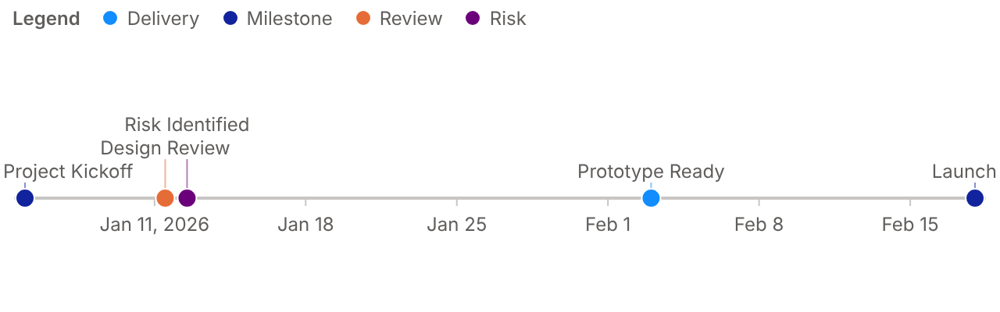

# powerbi_visuals_timeline_events

Custom Power BI visual that displays events on a horizontal timeline.



## Features
- Horizontal timeline with automatic date ticks (days, months, years), event dates, or start and end dates
- Events colored by **Legend** group with the report theme colors, or with colors picked in the editor
- **Lanes**: one row per value of the **Lane** field (for example a team or a project), with a shared date
  axis; the Legend still colors the events inside each lane; lanes scroll vertically (mouse wheel, touch,
  scroll bar) when there are more of them than the "Visible lanes" setting
- **Icons** in the markers, picked per event name or per Legend group in the editor, for all events in the
  Icons card, or from the Icon field; optional **date under the event name**
- **Editor** (Edit button of the visual header, Power BI's advanced edit mode): a color and an icon per Legend
  value and an icon per event name, saved with the report
- Event labels above, below or alternating, stacked on rows with leader lines; labels that don't fit are hidden
- Same-date events spread side by side, never on top of each other
- Native Power BI tooltips, including report page tooltips; hovering markers that touch or overlap shows one
  tooltip listing all their events, each followed by its Tooltips fields
- Times of day stored alone (`1899-12-30T12:46:25`) and ISO date-times sent as text are shown in the report
  locale (`12:46:25`)
- Selection and cross-filtering: click an event or a legend item, Ctrl+click to add, click the background to clear
- Context menu, keyboard navigation (arrow keys, Enter), bookmarks
- Optional "Today" line
- Format pane in the Power BI style: Legend, Lanes, Colors, Markers, Icons, Date axis, Event labels, Today line
- English and French, numbers and dates formatted with the model's format strings and the report locale
- High contrast mode, landing page, rendering events

## Data Roles
- Date (one field: a date column, or text dates such as `2026-01-05`)
- Event name (one field)
- Legend (optional, one field): groups and colors the events
- Lane (optional, one field): puts the events of each value on their own row
- Icon (optional, one field): icon of each event, as an icon name (English or French, see below),
  or one or two characters such as an emoji
- Tooltips (one or more fields, formatted with the model's format strings)

> If the Date field shows a date hierarchy (Year / Quarter / Month / Day), click the arrow next to the
> field in the Date well and select the column name instead of "Date Hierarchy".

## Icons
Icons come from [Fluent UI System Icons](https://github.com/microsoft/fluentui-system-icons) (MIT License,
Copyright (c) 2020 Microsoft Corporation), the icon set of Microsoft 365 and Power BI. A selection is embedded in
`src/icons.ts`: Power BI visuals may not load files from the internet. Matching ignores case and accents.

Which icon an event gets, from the strongest to the weakest choice:
1. The icon chosen for its **event name** in the editor ("None" removes the icon, "Automatic" moves on).
2. The value of the **Icon** field on its row.
3. The icon chosen for its **Legend** value in the editor.
4. Without a Legend field, the icon chosen for **all events** in the Icons card.

| Icon | French names |
|------|--------------|
| `flag` | drapeau, jalon |
| `check` | coche, valide, ok, termine, fait |
| `warning` | alerte, avertissement, attention, risque |
| `info` | information |
| `question` | aide |
| `bell` | cloche, notification, rappel |
| `star` | etoile, favori |
| `heart` | coeur |
| `target` | cible, objectif |
| `trophy` | trophee, succes |
| `rocket` | fusee, lancement |
| `flash` | eclair, urgent |
| `lightbulb` | ampoule, idee |
| `search` | loupe, recherche, revue |
| `calendar` | calendrier, reunion |
| `clock` | horloge, delai, heure |
| `location` | lieu, localisation |
| `people` | equipe, groupe |
| `person` | personne, utilisateur |
| `handshake` | accord, contrat, partenariat |
| `chat` | discussion, message |
| `mail` | courrier, email, e mail |
| `megaphone` | annonce, communication |
| `document` | fichier |
| `book` | livre, documentation |
| `briefcase` | mallette, projet |
| `money` | argent, budget, euro, finance |
| `cart` | panier, achat, commande |
| `truck` | camion, livraison |
| `airplane` | avion, voyage |
| `box` | colis, carton, produit |
| `building` | batiment, entreprise |
| `home` | maison, accueil |
| `settings` | parametres, reglages, configuration |
| `wrench` | outil, maintenance |
| `code` | developpement |
| `bug` | bogue, anomalie, defaut |
| `database` | base de donnees, donnees |
| `cloud` | nuage |
| `lock` | cadenas, securite |
| `shield` | bouclier, protection |
| `chart` | graphique, tendance, analyse |

## Sample Data (use for screenshot)

| Date       | Event Name       | Legend    | Tooltip1        | Tooltip2        |
|------------|------------------|-----------|-----------------|-----------------|
| 2026-01-05 | Project Kickoff  | Milestone | Owner: Alex     | Status: Open    |
| 2026-01-12 | Design Review    | Review    | Owner: Kim      | Status: Done    |
| 2026-01-12 | Risk Identified  | Risk      | Severity: High  | Status: Open    |
| 2026-02-03 | Prototype Ready  | Delivery  | Owner: Sam      | Status: Done    |
| 2026-02-18 | Launch           | Milestone | Region: EU      | Status: Planned |

## Development
```bash
npm install
npm start          # pbiviz start --all-locales
npm run package    # pbiviz package --all-locales -> dist/*.pbiviz
npm run lint
```

`--all-locales` keeps every culture of `powerbi-visuals-utils-formattingutils` in the bundle, so numbers and
dates follow the report's locale (e.g. `1 234,50 €` in French). Without it, `pbiviz` only keeps the locales
that have a `stringResources` folder.

### Data mapping
- A single **table** mapping carries the events (one row per Date / Event name / Legend / Lane / Icon /
  Tooltips combination, up to 30,000 rows). Selection ids are built per row with `withTable`.
- Power BI runs one query per visual, so a visual cannot add other data mappings (a second, categorical
  mapping made Power BI Desktop fail with "Cannot read properties of undefined (reading 'additionalProjections')").
  Colors and icons chosen per value in the editor are therefore saved as JSON, keyed by legend value or
  event name, in the hidden properties `colors.legendColors`, `icons.legendIcons` and `icons.eventIcons`
  (`host.persistProperties`).

### Microsoft recommendations
Implemented: rendering events, allow interactions, color palette, context menu, high contrast, keyboard focus,
landing page, localization, multi-visual selection, tooltips (default, report page and modern tooltips),
advanced edit mode.

Not applicable: **Highlight data** and **conditional formatting (fx)** are not supported by Power BI for
table data mappings, so `pbiviz package` still lists "Highlight Data" as missing.
